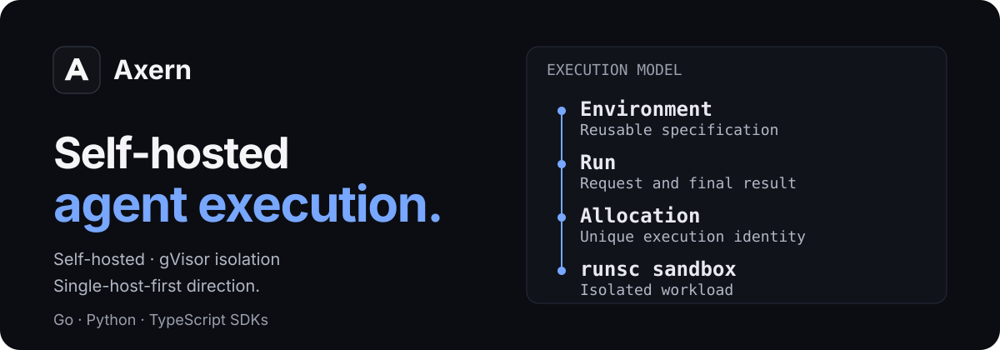
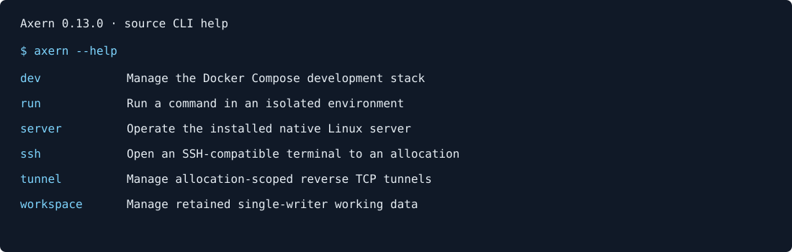
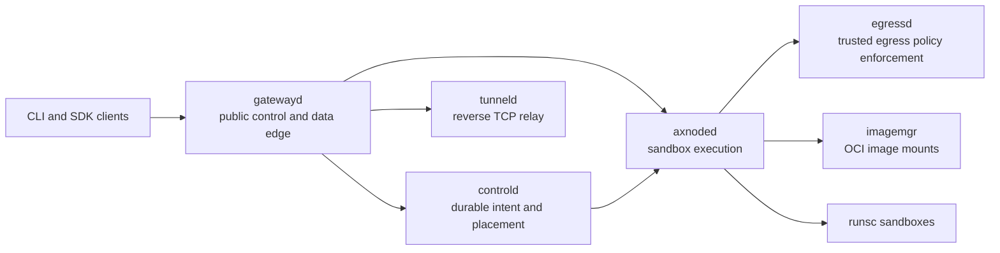

<p align="center">
  
</p>

<p align="center">
  <a href="https://github.com/cofy-x/axern/actions/workflows/ci.yml"></a>
  <a href="./LICENSE"></a>
</p>

<p align="center">
  <a href="https://axern.cofy-x.space">Documentation</a> ·
  <a href="https://axern.cofy-x.space/getting-started/">Quickstart</a> ·
  <a href="https://axern.cofy-x.space/sdk/">SDKs</a> ·
  <a href="./README.zh-CN.md">简体中文</a>
</p>

Axern is open-source, self-hosted infrastructure for **single-host agent execution and persistent workspaces**. It provides isolated execution through gVisor (`runsc`) and experimental single-writer Workspace resources. The CLI and Go, Python, and TypeScript SDKs expose the same public APIs for Environments, Runs, sandbox processes and files, Tunnels, lifecycle state, and Allocation-scoped access. gVisor/runsc is the sole long-term execution backend.

The primary use case is a personal agent system on one Linux host: independent workers, inspectable execution, retained working data, and a small operational surface. Agent sessions, configuration, planning, collaboration, and workflows belong to caller applications. See the [product direction](./docs/product/product-direction.md) and [single-host serving decision](./docs/decisions/single-host-agent-serving.md).

> **Project status:** Axern is pre-1.0 and under active development. An experimental [native Linux installation](./deploy/standalone/INSTALL.md) provides a source-built runtime archive and managed systemd lifecycle. It is not yet a published release channel or a supported upgrade path. Docker Compose remains the local development path. Optional Workspace data requires XFS project quotas; other writable storage is Allocation-local. Supported backup/restore and upgrades remain unqualified, and sealed outputs expire 15 minutes after cleanup begins. Review the current deployment and storage boundaries before use.

The durable chain is **Environment → Run → Allocation → runsc sandbox**. The following concepts describe how an agent system uses that chain; they do not introduce another execution lifecycle or an Axern Agent resource.

| Concept | Responsibility and status |
| --- | --- |
| Image | Immutable runtime, tools, and reference inputs. Environments resolve execution inputs and policy; read-only ImageMounts provide additional image content. |
| Workspace | **Experimental:** retained working data on one bound Node, with its own identity, authorization, block/inode capacity and explicit deletion. One fenced writer per Workspace. |
| Sandbox | The running execution view and SDK facade over one Run/Allocation, including its processes and filesystem access. It does not own a persistent Agent session. |
| AgentSession | Caller-owned conversation, configuration, planning, and coordination state; Axern executes the worker without interpreting that session. |

The default collaboration pattern is independent writable working directories, common read-only references, and explicitly published results that the caller merges or hands off. Use separate Workspaces or Allocation-local directories, read-only image mounts, and explicit result handoff. Simultaneous shared writable mounts remain outside the single-writer contract.

[Agent workload images](./images/agents/README.md) share a base and development toolchain, then add official Claude Code or Codex programs in separate layers. Build them locally with `make agent-images`; model credentials, provider selection, tasks and session policy remain runtime inputs owned by the caller.

<p align="center">
  
</p>

## Quickstart

For Linux single-host serving, build and stage a coherent native archive using the [installation guide](./deploy/standalone/INSTALL.md). Operate the installed server with `axern server start`, `status`, `logs` and `stop`. API contexts select remote execution services; they do not change the host managed by `server`.

This source tree introduces a coordinated protocol change. Build the CLI, services and SDKs from the same revision; a source version does not establish published package availability. For repository development on Linux or a macOS Linux VM, use Go 1.26.10, Make and Docker Compose v2:

```bash
make quickstart-source
make axern-cli-build
./bin/axern context list
```

`quickstart-source` builds current service images and verifies the source Compose stack. The packaged Compose lifecycle is `axern dev up|status|logs|down`; it is separate from the installed server and retains the machine-local context/data identity. A published CLI's development bundle requires its matching published service images. See the [CLI contract](./apps/cli/README.md) for deployment commands and contexts.

[Workspace usage](./apps/docs/src/content/docs/guides/workspaces.md) covers retained files through fresh Runs. Without a Workspace, existing ephemeral execution stays available. Agent programs, tasks and session recovery remain caller-owned.

For repository development, `make verify-changed` is the normal fast feedback entrypoint. Linux correctness, full regression, and release qualification are separate tiers. Every `main` commit starts a commit-bound full regression; a green PR check does not imply that this later run has passed. Check [Post-Merge Full](https://github.com/cofy-x/axern/actions/workflows/post-merge-full.yml) before release or promotion; see the [verification tiers](./docs/verification/local-full-verification.md).

## What You Can Build

- **Agent sandboxes:** execute agent-generated code behind a runsc isolation boundary while retaining process, file, terminal, and output APIs.
- **Concurrent agent tasks:** execute coding, research, evaluation, or data processing work through independent Runs, with explicit inputs, outputs, and lifecycle evidence.
- **SDK-driven execution:** use a released SDK to create Runs, operate their Allocations, seal bounded declared outputs, publish a successful writable rootfs as a reusable Environment, and recover by public resource identity.

## Why Axern

- **Execution for your agent system:** compose isolated agent tasks through the same Run execution model while keeping planning, memory, and collaboration in your application.
- **Durable control plane:** PostgreSQL-backed intent, placement, leases, allocation-scoped status, health, and cleanup state remain authoritative across process or node restarts.
- **One production runtime:** runsc workloads use the same public APIs; OCI images provide reproducible rootfs inputs.
- **Real data-plane access:** process streams, files, archives, SSH-compatible terminals, and reverse TCP tunnels are explicit allocation capabilities.
- **A focused direction:** prioritize simpler single-host deployment and persistent working data; existing Compose, kind, and Helm deployment contracts remain documented while that work is implemented.

## Architecture



`gatewayd` is the unified external gateway for public control and Allocation-scoped data-plane traffic; `controld` and PostgreSQL remain authoritative for product state, while node services own host-local execution, images, networking, and Allocation-local writable storage. A Run can declare a bounded set of files or tar archives for node-local sealing before runtime cleanup; callers download and durably publish those bytes before the reported output expiry, which is 15 minutes after cleanup begins. A successful finite Run may separately publish its complete writable rootfs as a content-addressed OCI image and ordinary reusable Environment. Neither path creates a persistent workspace or generic object store. See the [storage architecture](./docs/architecture/storage-architecture.md), [runtime architecture](./docs/architecture/runtime-architecture.md), and [resource model](./docs/architecture/resource-model.md).

Public clients are available in Go, Python, and TypeScript under [`sdk/`](./sdk/README.md). Shared wire contracts are defined in [`sdk/proto`](./sdk/proto/README.md).

## Kubernetes Install

Follow the [Kubernetes installation guide](./apps/docs/src/content/docs/getting-started/kubernetes.md) to provision signing material, supply qualified node memory reserves, bind explicit Node identities, install the control plane, and admit nodes before waiting for runtime readiness. SSH is optional and uses Principal Credentials. Do not skip the identity and admission steps by running a bare Helm install.

Treat each Axern release as one coordinated CLI, SDK, chart, and runtime version. Review its [release notes](./docs/releases/) before upgrading and use artifacts only after publication completes; a source version is not proof of artifact availability. The command overview is generated from source CLI help; it is not a deployed workload or performance measurement.

## Deployment

- [Native Linux installation](./deploy/standalone/INSTALL.md) is the experimental single-host systemd path; [payload construction](./deploy/standalone/README.md) records its build and qualification boundaries.
- [Docker Compose and kind](./deploy/local/README.md) are the repository-owned local truth environments.
- The [Axern Helm chart](./deploy/helm/axern/README.md) is cloud-neutral and accepts operator-owned image registries, certificates, storage classes, and secrets.
- Provider account setup, cluster creation, credentials, and regional release automation intentionally live outside this repository.

Axern does not claim that a default local or example deployment is safe for an untrusted multi-tenant environment. Review authentication, TLS, network policy, runtime isolation, image trust, secret storage, resource limits, and persistent storage before production use. Report vulnerabilities according to [SECURITY.md](./SECURITY.md).

## Contributing

Contributions are welcome. Read [CONTRIBUTING.md](./CONTRIBUTING.md), follow the [Code of Conduct](./CODE_OF_CONDUCT.md), and sign every commit under the [Developer Certificate of Origin](./DCO). Project decisions follow the [governance model](./GOVERNANCE.md).

## License

Copyright 2026 cofy-x.

Licensed under the [Apache License, Version 2.0](./LICENSE).
