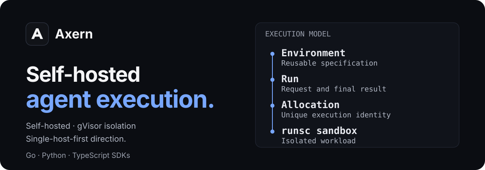
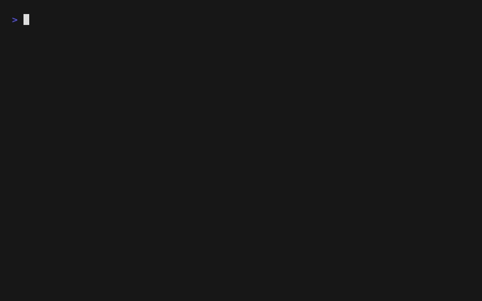
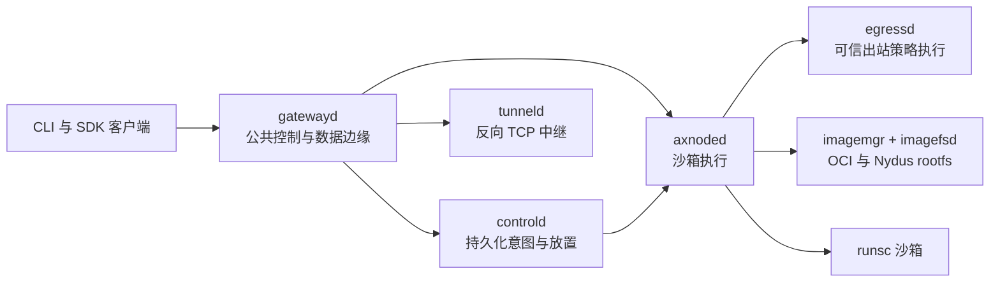

<p align="center">
  
</p>

<p align="center">
  <a href="https://github.com/cofy-x/axern/actions/workflows/ci.yml"></a>
  <a href="./LICENSE"></a>
</p>

<p align="center">
  <a href="https://axern.cofy-x.space/zh-cn/">文档</a> ·
  <a href="https://axern.cofy-x.space/zh-cn/getting-started/">快速开始</a> ·
  <a href="https://axern.cofy-x.space/zh-cn/sdk/">SDK</a> ·
  <a href="./README.md">English</a>
</p>

Axern 是一个面向 AI agent 的开源、自托管执行平台。它用 gVisor（runsc）隔离运行 agent 生成的代码，使用统一的资源与生命周期模型。执行运行时统一使用 runsc，不提供运行时回退。CLI 与 Go、Python、TypeScript SDK 暴露相同的公共 API，覆盖 Environment、Run、Sandbox 进程与文件、Tunnel、生命周期状态和 allocation 范围的访问能力。

产品方向是**以单机为先的个人 Agent 系统基础设施**：简化 Linux 部署，支持长期运行的沙箱服务，以及通过明确访问权限和所有权供多个 agent 使用的持久 Workspace。Agent 的规划、协作与工作流由调用方应用负责。详见[产品方向](./docs/product/product-direction.md)和[单机 serving 决策](./docs/decisions/single-host-agent-serving.md)。

> **项目状态：** Axern 处于 pre-1.0 阶段，仍在活跃开发中。实验性的 [Linux 原生安装](./deploy/standalone/INSTALL.md)已支持从源码构建运行时包，尚未纳入正式发布渠道，也不支持升级。持久 Workspace 资源仍在计划中。当前本地路径是 Docker Compose 开发栈；可写存储属于 Allocation，封存输出在清理开始 15 分钟后过期。使用前请审阅当前部署与存储边界。
>
> 本文档为中文译文，内容以 [英文版](./README.md) 为准。

持久领域链路为 **Environment → Run → Allocation → runsc sandbox**。Sandbox 是这条链路上的 SDK 门面，不建立第二套执行生命周期。

<p align="center">
  
</p>

## 快速开始

受支持的本地开发路径通过 Docker Compose 运行完整技术栈：Linux 上直接运行，macOS 上通过 Docker Desktop 的 Linux VM 运行。只需要 `axern` CLI 和 Docker Compose v2，不需要源码检出、Make、Helm 或任何语言工具链。两种情况下，gVisor 执行层都运行在 Linux 上。

```bash
brew install cofy-x/tap/axern
```

没有 Homebrew 时，使用带校验和的独立安装脚本：

```bash
curl -fsSL https://raw.githubusercontent.com/cofy-x/axern/main/install.sh | sh
```

然后启动 Axern 并运行第一个工作负载：

```bash
axern local up
axern local image load python:3.12-slim --pull
axern run python:3.12-slim -- python -c 'print("hello from axern")'
```

`local up` 会启动 PostgreSQL 以及 Axern 的控制、隧道、节点和网关组件，等待就绪，并创建 `local` 上下文。`local image load` 会把选定的宿主 Docker 镜像直接流式导入本地节点，不生成中间归档文件：

```bash
axern context current
axern run list
axern local status
axern local down
```

本地环境使用生成的开发凭据和回环监听地址，不要在共享或生产部署中复用它们。

可信的本机 HTTP registry 可以通过重复的 `axern local up --insecure-registry host[:port]` 参数显式授权。control 和 node 容器必须都能通过这个完全一致的 hostname 访问 registry；仅容器可见的 registry 可以接入 `axern local status` 报告的 `axern-local-registry` Docker 网络。详见 [CLI 契约](./apps/cli/README.md#local-external-http-registries)。HTTPS 仍是默认策略，而且这个仅限本地环境的设置不属于 Environment specification。

源码开发是独立的贡献者路径。它把当前检出构建为本地 `:dev` 镜像，并验证相同的公共契约：

```bash
make quickstart-source
```

仓库开发通常使用 `make verify-changed` 获得快速反馈。Linux correctness、完整回归和发布资格验证属于不同层级；每个 `main` 提交都会启动绑定该提交的完整回归，PR 检查通过不代表后续回归已通过。发布或晋级前检查 [Post-Merge Full](https://github.com/cofy-x/axern/actions/workflows/post-merge-full.yml)，详见[验证层级](./docs/verification/local-full-verification.md)。

## 可以构建什么

- **Agent 沙箱：** 在 runsc 隔离边界后执行 agent 生成的代码，同时保留进程、文件、终端和输出 API。
- **并行 Agent 任务：** 通过独立 Run 执行编码、研究、评测或数据处理任务，并显式记录输入、输出和生命周期证据。
- **SDK 驱动执行：** 通过正式发布的 SDK 创建 Run、操作其 Allocation、封存有限的声明输出、将成功执行后的可写 rootfs 发布为可复用 Environment，并使用公共资源身份恢复查询。

## 为什么选择 Axern

- **服务你的 Agent 系统：** 通过同一套 Run 执行模型组合隔离任务，规划、记忆和协作逻辑由你的应用负责。
- **持久化控制平面：** 以 PostgreSQL 为后端的意图、放置、租约、Allocation 级状态、健康和清理信息，在进程或节点重启后依然保持权威。
- **单一生产运行时：** runsc 工作负载使用相同的公共 API；OCI 与 Nydus 镜像路径在节点运行时汇聚。
- **真实的数据面访问：** 进程流、文件、归档、SSH 兼容终端和反向 TCP 隧道都是 allocation 的显式能力。
- **聚焦的演进方向：** 优先简化单机部署并支持持久工作数据；这些能力实现期间，现有 Compose、kind 和 Helm 部署契约仍有文档说明。

## 架构



`gatewayd` 是公共控制流量和 Allocation 范围数据面流量的统一外部网关；`controld` 和 PostgreSQL 保持产品状态权威，节点服务负责宿主机本地执行、镜像、网络和 Allocation 私有的临时可写存储。Run 可以声明有限的文件或 tar 归档，由节点在 runtime 清理前封存；调用方必须在返回的输出过期时间前下载并持久发布这些字节，该截止时间为清理开始 15 分钟后。成功的有限 Run 还可以独立地把完整可写 rootfs 发布为内容寻址 OCI 镜像和普通可复用 Environment。两条路径都不会创建持久 Workspace 或通用对象存储。详细契约见[存储架构](./docs/architecture/storage-architecture.md)、[运行时架构](./docs/architecture/runtime-architecture.md)和[资源模型](./docs/architecture/resource-model.md)。

公共客户端提供 Go、Python 和 TypeScript 版本，位于 [`sdk/`](./sdk/README.md)。共享的传输契约定义在 [`sdk/proto`](./sdk/proto/README.md)。

## Kubernetes 安装

按照 [Kubernetes 安装指南](./apps/docs/src/content/docs/zh-cn/getting-started/kubernetes.md) 初始化签发材料、提供经过验证的节点内存预留值、绑定明确的 Node 身份、安装控制面，并在节点准入后等待运行时就绪。SSH 是可选能力，使用 Principal Credential。不要用裸 Helm install 跳过身份和准入步骤。

每个 Axern Release 都应视为配套的 CLI、SDK、Chart 和运行时版本。升级前请阅读对应的[发布说明](./docs/releases/)，并仅在发布完成后使用正式产物；源码版本号不代表产物已经可用。终端录制展示当前源码的 CLI 帮助，不是已部署工作负载或性能测量。

## 部署

- [Linux 原生安装](./deploy/standalone/INSTALL.md)提供实验性的单机 systemd 部署路径；[运行时包说明](./deploy/standalone/README.md)记录构建和验收边界。
- [Docker Compose 和 kind](./deploy/local/README.md) 是仓库自持的本地基准环境。
- [Axern Helm chart](./deploy/helm/axern/README.md) 是云中立的，接受运维方自持的镜像仓库、证书、存储类和密钥。
- 云厂商账号准备、集群创建、凭据和区域发布自动化有意放在本仓库之外。

Axern 不声称默认的本地或示例部署对不可信多租户环境是安全的。生产使用前请审阅认证、TLS、网络策略、运行时隔离、镜像信任、密钥存储、资源限制和持久存储。报告漏洞请遵循 [SECURITY.md](./SECURITY.md)。

## 参与贡献

欢迎贡献。请阅读 [CONTRIBUTING.md](./CONTRIBUTING.md)，遵循[行为准则](./CODE_OF_CONDUCT.md)，并在[开发者来源证书（DCO）](./DCO)下签署每个 commit。项目决策遵循[治理模型](./GOVERNANCE.md)。

## 许可证

Copyright 2026 cofy-x.

基于 [Apache License, Version 2.0](./LICENSE) 授权。
