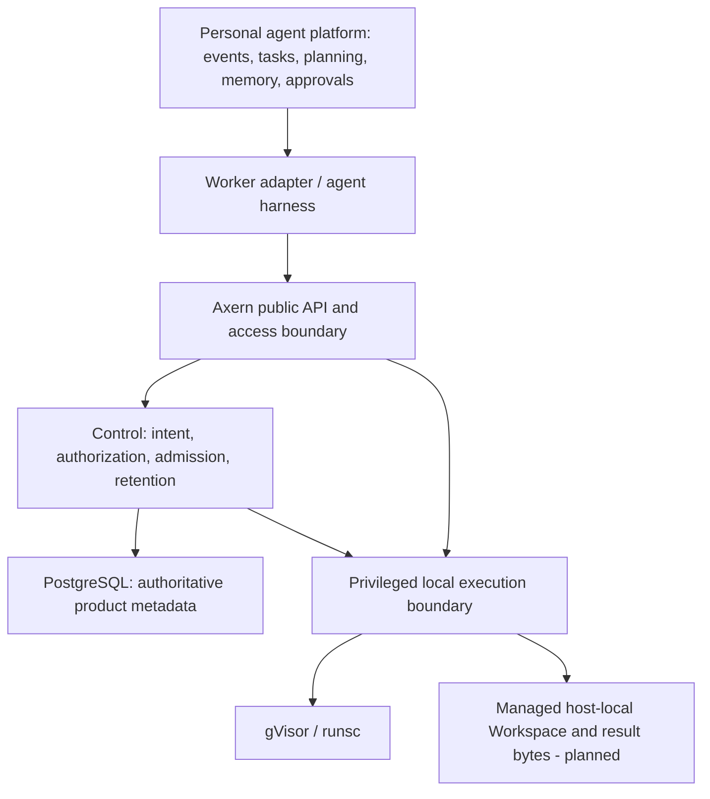

# Single-Host Agent Serving

## Decision And Status

Axern's direction is a self-hosted execution platform for AI agents, optimized for continued work on one Linux host. gVisor/runsc is the sole long-term execution backend. Persistent Workspace and a qualified standalone serving profile are accepted product goals; they are not implemented by this documentation change.

This decision supersedes the conditional second-runtime direction in [Firecracker Evaluation Boundary](firecracker-evaluation-boundary.md). The [Product Direction](../product/product-direction.md) owns the enduring scope. The [roadmap issue](https://github.com/cofy-x/axern/issues/195) and linked phase issues own delivery status, dependencies, and verification evidence; the current [Domain Model](../product/domain-model.md), [Runtime Architecture](../architecture/runtime-architecture.md), and [Storage Architecture](../architecture/storage-architecture.md) continue to describe implemented contracts.

## Rationale

Personal agent work needs environments that are easy to operate, can run background work, retain useful files, and allow a human to inspect and continue a task. Evaluation, training, and synthesis remain valid workloads, but fleet scale and transient batch throughput no longer determine the default architecture. A real multi-agent workflow should drive investment before speculative backend, cluster, or snapshot generalization.

The existing execution identities, authority checks, runtime recovery, and cleanup mechanisms remain valuable. Simplification should reduce configuration, deployment units, and failure coordination while preserving those boundaries. A single command or package is useful; forcing all code into one privileged process is not a goal.

## Current Baseline And Target

This assessment uses source baseline `c0d8444964d21468d2e778a769570cc7b21b00ef` (v0.12.1). It is a design baseline, not a claim that a current host or release artifact has passed qualification.

| Concern | Current implementation | Target |
| --- | --- | --- |
| Local startup | CLI-managed Compose with PostgreSQL and multiple services; generated development identity, loopback listeners, and `disabled_dev` cgroup enforcement | One qualified Linux installation and managed service lifecycle with required enforcement enabled |
| macOS | CLI and local stack through a Linux VM | Client and VM development experience; no native macOS runsc implementation |
| Execution | Environment -> Run -> Allocation; Sandbox facade; runsc only | Preserve the execution chain and permanently select gVisor/runsc |
| Working files | Allocation-local writable rootfs; no persistent Workspace API | Independently retained, authorized host-local Workspace data |
| Results | Bounded node-local outputs; successful rootfs sealing creates an immutable Environment | Explicit retained-result delivery with inspectable success, retention, and failure |
| Connections | Processes, terminals, SSH, and reverse Tunnels | Reconnectable work and authenticated service previews with explicit execution identity |
| Maintenance | Pre-stable schema changes use coordinated rebuilds; local refresh paths can reset state | Supported-version migration, protected backups, restore, and observable restart recovery |

Current local Compose must not be relabeled as the qualified serving profile. Existing commands and published APIs remain valid until an implementation changes them explicitly; this decision defines no new executable command or released API.

## Target Ownership

This is an ownership diagram, not a promise that each box is a separate daemon. The target installation manages one public endpoint and configuration surface, a control service, the necessary local execution/helpers, and PostgreSQL. Public traffic must not inherit host operator authority when components share a package or process. Remote transports can be removed or localized only with an explicit equivalent authorization and failure contract.

Axern owns execution and data facts: what is running, where authorized files live, which writer owns an attachment, what resources are charged, what bytes were delivered, and whether cleanup is confirmed. The upper agent platform owns task completion, Agent roles, model choice, memory, scheduling policy, messages, approvals, semantic retries, result merging, and external effects. A worker protocol and its Session meaning belong to the adapter rather than Axern's domain model.

Running a worker's complete harness inside a sandbox is the preferred first integration shape. Redirecting only shell commands is insufficient if filesystem operations, background jobs, or subagents still execute on the host. An adapter must enumerate those paths and its scoped model/credential transport; Axern need not understand the harness's private Session format.

## Persistent Workspace Boundary

Workspace is planned as a namespace-scoped data resource with an identity and lifetime independent of a Run or Allocation. It is not an Environment property, a persistent Sandbox object, or an Agent Session. An Environment remains immutable execution input. A new execution from retained files still creates a new Run and Allocation; old execution identities and access grants are never reused. A Workspace handle must not silently redirect an old process, terminal, or file-operation handle to a replacement Allocation.

- **Authority and location:** PostgreSQL owns Workspace metadata, authorization, attachment intent, and retained storage accounting. One managed Linux host owns the bytes and mount observations. Missing or inaccessible data is explicit, never an empty successful recovery or an automatic cross-host reschedule.
- **Attachment:** Run admission freezes the authorized Workspace reference. The first version permits one writer. Transferring write ownership requires evidence that the old runtime and writable attachment have stopped or equivalent enforced fencing; database lease expiry alone is insufficient. Define any read-only access consistently with live writers rather than implying a snapshot.
- **Capacity:** retained bytes remain charged when detached. Workspace capacity is separate from the current ephemeral rootfs charge and needs its own enforced accounting and full-disk behavior.
- **Isolation:** callers cannot select arbitrary host paths. Mount validation, traversal/symlink handling, namespace authorization, and secret projection boundaries must remain enforceable through attachment, access, backup, and deletion.
- **Retention and deletion:** stopping or deleting a sandbox does not delete Workspace data. Workspace deletion is an explicit authorized operation, blocked by active or ambiguous attachments until ownership and cleanup converge. Retention policies must be visible rather than silently inherited from Run output TTLs.
- **Recovery:** retained files enable rebuilding work, not transparent process continuation. Host reboot, node/disk loss, and restoring a backup have distinct outcomes. Upper-layer recovery decides whether to restart a worker or retry an external action.

The existing successful-Run rootfs snapshot remains an immutable Environment result, not a mutable Workspace or process checkpoint. Existing reverse Tunnels connect sandbox workloads to caller-owned services; inbound authenticated preview requires its own access contract. Existing 15-minute declared-output retention remains unchanged until the relevant implementation lands.

For initial durable handoff, define explicit publication to retained Workspace data or caller-owned storage, with receipts for the actual bytes. Do not add a generic object store or another public Artifact root without an independently justified lifecycle. A cold backup may be the first supported backup mechanism, but it must coordinate metadata, data, required recovery facts, and encryption/identity material; an unrelated database dump and copy of live directories is not a consistency guarantee.

Recovery also needs immutable Environment image digests, supported runtime versions, and an explicit registry retention/access responsibility. A restore is not proven merely because files are readable: qualify a fresh Allocation from the original immutable Environment with the recovered data. Missing images or credentials must produce an explicit failure, never tag drift or an empty replacement environment. Fence the previous installation before regranting writer authority, and do not revive stale Allocation leases from a backup.

## Module Dispositions

The table describes implementation direction, not completed moves or module deletion. Linked module contracts continue to own current technical behavior.

| Existing module or dependency | Disposition | Planned treatment and constraint |
| --- | --- | --- |
| `apps/cli`, Go/Python/TypeScript SDKs, `sdk/proto` | Keep and simplify the common path | One standalone setup/diagnostic experience; add Workspace and reconnect contracts atomically across public surfaces. Preserve explicit IDs and error semantics. |
| `control/controld` | Keep authority; consolidate deployment | Retain intent, authorization, resource charge, and lifecycle; add Workspace metadata. Local placement should not require cluster operations. |
| `gateway/gatewayd` | Consolidate compatible control wiring | Evaluate one control-service composition with `controld`; preserve public access checks, stream behavior, revocation, and no host-operator privilege. A process merger requires failure tests. |
| `controld-retention`, migration and access bootstrap jobs | Fold into managed lifecycle | Integrate retention scheduling and one-shot setup/upgrade orchestration without competing writers or resetting existing state. Keep migration ordering explicit. |
| PostgreSQL | Keep one authority | Manage installation, backup and upgrades. Do not add SQLite or dual state backends during this transition. |
| `runtime/axnoded`, `axern-sandboxd`, runsc | Keep execution boundary | Own runtime, processes, mounts, enforced limits, local recovery and cleanup. Pin/manage the full runtime package and qualify systrap as the initial serving platform on supported Linux hosts. No additional backend or runtime registry. |
| `runtime/egressd` | Keep enforcement responsibility | Managed local helper with explicit privilege and health checks. Co-packaging must not bypass fail-closed network policy. |
| `runtime/tunneld`, node tunnel connector | Consolidate deployment where justified | Preserve finite allocation authority and reverse-relay behavior. Co-locate wiring where useful; do not confuse relay consolidation with adding authenticated preview. |
| `runtime/imagemgr` | Keep and narrow default dependencies | Preserve OCI pull/cache/rootfs ownership. Audit startup coupling before making Nydus-specific dependencies optional; ordinary OCI currently does not imply those dependencies can simply be deleted. |
| `runtime/imagefsd`, Nydus, chunk/P2P paths | Defer new optimization; isolate optional path | Keep existing supported behavior until an explicit compatibility change. Make it unnecessary for the default OCI installation only after dependency and cleanup tests prove separation. |
| `network/bpfnet` and alternate host-network paths | Keep a qualified default; defer expansion | Select one tested Linux serving profile. Changing backend is a separate enforcement qualification, not a shortcut to fewer services. |
| `deploy/local` | Keep development workflow | Preserve macOS/Linux local development, while separating it clearly from the qualified Linux serving profile. |
| Helm/kind, cluster/HA/multi-region work | Maintain existing contracts; defer new scope | They must not be prerequisites for the personal installation. Removing an existing deployment path needs an explicit migration decision. |
| Local registry and observability services | Manage or make optional by demonstrated need | Consume existing OCI images first; document registry/cache needs. Diagnostics are required, a full metrics dashboard stack is not a first-task prerequisite. |
| `apps/docs` and root documentation | Keep aligned with evidence | Publish current commands and capabilities; label planned behavior and route implementation status to issues. |
| Axrun, Kova, and agent harnesses | External consumers or optional producers | Axrun retains its evaluation contract; Kova can supply images but is not required. Agent orchestration and worker adapters remain outside Axern. |

## Phased Delivery

Each phase issue owns its checklist, implementation PRs, and actual acceptance results. Phase numbers express dependencies, not calendar promises. Contract design can overlap, but dependent behavior must not be advertised before its prerequisites pass. During Phases 1–2, run a bounded consumer compatibility experiment with a complete worker, filesystem tools, background jobs, subagents, and model connectivity inside the execution boundary. Use its findings to shape the contracts; Phase 5 still owns complete integration acceptance after qualification.

| Phase | Scope | Dependency and exit evidence |
| --- | --- | --- |
| [0: Positioning and architecture](https://github.com/cofy-x/axern/issues/196) | Product descriptions, boundaries, module dispositions, and this decision | Reviewed current/planned separation and documentation checks |
| [1: Linux standalone baseline](https://github.com/cofy-x/axern/issues/197) | Managed setup/configuration, enforced runsc path, component consolidation and OCI dependency simplification | Phase 0; fresh-host real sandbox, resource/network enforcement, preserved data on restart, measured operational footprint |
| [2: Persistent Workspace](https://github.com/cofy-x/axern/issues/198) | Independent data lifecycle, authorization, attachment, fencing, capacity and deletion | Phase 1 runtime/storage baseline; restart/recreate retention and competing-writer/deletion/failure tests |
| [3: Reconnect and handoff](https://github.com/cofy-x/axern/issues/199) | Background work, terminal recovery, authenticated preview and explicit result delivery | Phase 2; disconnect, revocation, cleanup and delivery-failure acceptance |
| [4: Stateful maintenance](https://github.com/cofy-x/axern/issues/200) | Supported upgrades, consistent backup/restore, reboot and failure convergence | Phase 1 baseline plus Phase 2/3 data contracts; isolated restore and supported-version upgrade preserving data and authority |
| [5: Personal-agent pilot](https://github.com/cofy-x/axern/issues/201) | External adapter, two isolated workers, human inspection and retained follow-up | Phases 1–4; reproducible complete task and interruption scenarios using public APIs |

Phase 1 establishes the executable Linux baseline; its release/backup design must precede persistent data work. Phase 4 qualifies the complete stateful maintenance contract. Until that passes, the new profile remains evaluation-only rather than claiming long-term service readiness. The current rebuild-only schema policy cannot silently become the upgrade policy for retained personal work.

The pilot uses separate Workspaces for independent writers and explicit caller-owned result merging. It must distinguish controller/client restart from full host reboot, show that sandbox destruction preserves data, and require explicit Workspace deletion. A human handoff must coordinate with the worker's writing policy; a terminal connection by itself does not establish exclusive access.

## Consequences And Revisit Conditions

The platform accepts a narrow persistent-data responsibility and the maintenance obligations that follow. That increases storage correctness work while reducing investment in alternative runtimes and fleet-oriented features. PostgreSQL and necessary helpers remain dependencies; this decision promises a smaller managed operational surface, not a dependency-free binary.

Keep module consolidation when measured configuration, startup, idle footprint, and recovery improve without weakening authorization, cleanup, or debugging. Revisit a specific consolidation if it broadens privilege or worsens fault recovery. Consider deferred scaling or image optimization only when an actual single-host workload demonstrates the gap. The gVisor-only choice is the durable product constraint, not a pending comparison experiment.
