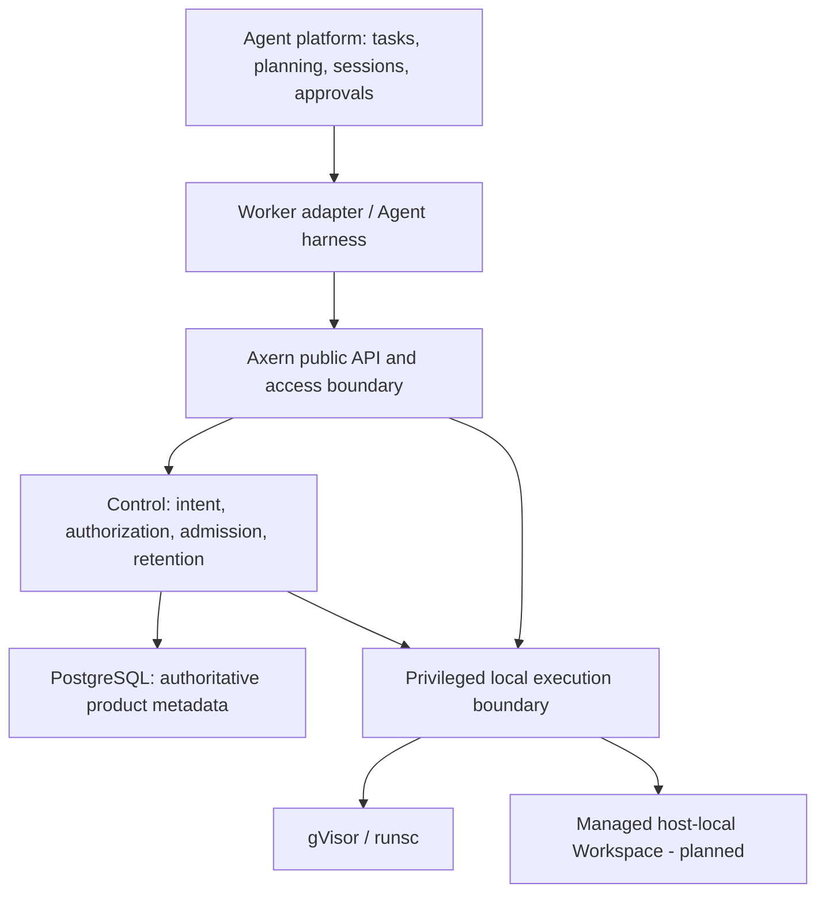

# Single-Host Agent Serving

## Decision

Prioritize one Linux installation for Agent execution and independently retained working data. Use gVisor/runsc as the sole sandbox backend and PostgreSQL as the sole authoritative product-state store. Preserve `Environment -> Run -> Allocation`; Sandbox remains the SDK facade and Agent sessions remain caller-owned.

The [Product Direction](../product/product-direction.md) owns scope and capability status. The [Domain Model](../product/domain-model.md), [Runtime Architecture](../architecture/runtime-architecture.md) and [Storage Architecture](../architecture/storage-architecture.md) own implemented contracts. The [native installation guide](../../deploy/standalone/INSTALL.md) owns executable deployment instructions and its experimental support boundary.

## Rationale

Personal Agent work benefits from a small installation, inspectable background execution and useful files that survive an execution's end. A single-host design keeps placement, storage ownership and maintenance understandable without introducing cluster operations. Evaluation and batch workloads can use the same primitives without determining the default architecture.

Fewer configuration surfaces and dependencies reduce coordination work. Public access checks, privileged execution and confirmed cleanup still need explicit owners; sharing a package or process cannot turn a public request into host-operator authority.

## Ownership And Deployment

These labels describe responsibilities, not a required daemon count. The installation manages one public endpoint/configuration surface, PostgreSQL and the local execution helpers it needs. Component and transport layout belongs to the runtime architecture. Consolidation must preserve authorization, stream behavior, revocation, cleanup and useful failure diagnosis.

Axern owns execution facts: admission, exact execution identity, resource charge, access and cleanup. The planned Workspace adds retained-data facts under the same control authority. The caller owns task completion, model choice, worker configuration, conversation state, approvals, semantic retries, result merging and external effects.

A worker's complete harness belongs inside its Sandbox when its files, background jobs and tool processes require that boundary. Redirecting shell commands alone cannot isolate other host-side operations. Adapters define the worker protocol and credential/model transport; Axern does not interpret an Agent's private session format.

[Workload image recipes](../../images/agents/README.md) reuse a fixed development toolchain and add separate Agent program layers. Model settings, tasks, credentials and session policy remain runtime caller inputs. Image-building services and registry operation remain external infrastructure rather than Axern-managed serving components.

## Retained Data

Image supplies immutable tools and inputs; Environment supplies their public execution-input identity and policy. Workspace is the planned independently retained data identity, while a new execution always creates a new Run and Allocation. No Workspace reference redirects an old process, file, terminal, SSH or Tunnel handle to a replacement execution.

The [single-writer Workspace decision](single-writer-workspaces.md) owns attachment, retained capacity, fencing, deletion, storage identity and cold-restore requirements. Its first contract is one managed host-local writer, not a distributed or shared multi-writer volume. Unknown cleanup cannot transfer writer authority, and lease expiry alone cannot prove the old writer is gone.

Current file/output APIs support caller-owned export, verification and restoration of selected bytes. Those operations do not create a native Workspace or shared writable mount. Successful-Run rootfs sealing creates an immutable Environment, not mutable retained data or a process checkpoint. Output lifetime and delivery guarantees remain in the storage architecture.

Retaining personal work introduces stateful maintenance obligations. Supported upgrades and consistent isolated restore must be qualified before advertising the corresponding durability or recovery guarantee. A database dump and unrelated live directory copy cannot establish that guarantee.

## Simplification And Revisit Conditions

Keep one execution chain and one state owner while reducing installation and operational complexity. Components may be combined, localized or removed with their affected callers and contracts; preserve privilege separation and failure behavior rather than a fixed module list.

OCI is the native image path. Kubernetes deployments and Nydus/image-cache optimizations remain optional and need a concrete workload to justify maintenance or expansion. Cloud accounts, regional orchestration, high availability, worker planning and model policy stay outside the serving core.

Revisit a component boundary when actual operation exposes avoidable configuration, resource cost or fault-recovery problems. Revisit a deferred scaling or storage feature when a real workload demonstrates the need. The gVisor-only choice remains a product constraint.
