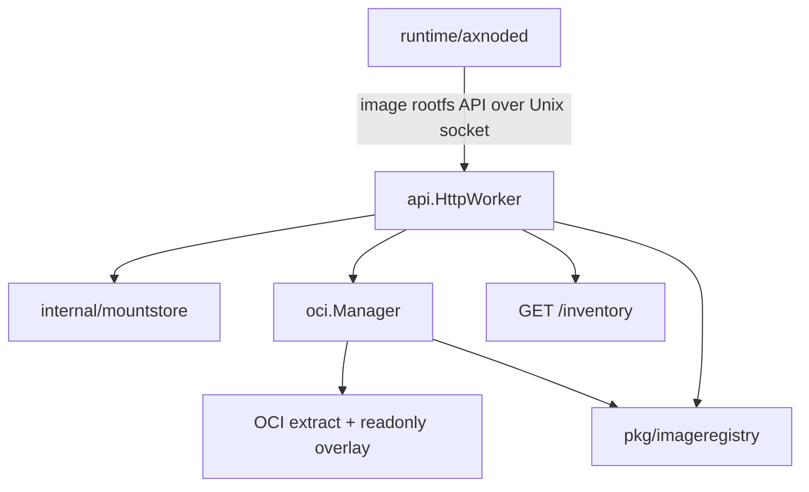
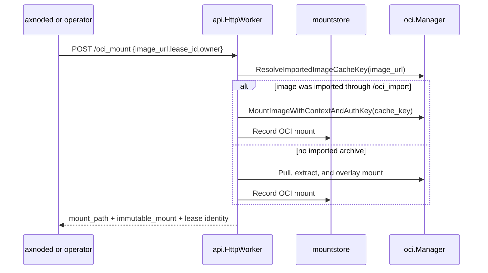

# Imagemgr Architecture

`imagemgr` is the node-local OCI image daemon used by `axnoded`. Its API owns resource leases and request orchestration; `oci` owns image extraction, read-only overlay mounts and backend recovery.

Use this document when changing mount leases, recovery, inventory or the `axnoded` to `imagemgr` integration. Commands and supported flags are in the [module README](../README.md).

## Implementation Map

## API Ownership

| Entry point         | Primary owner                                  | Result                                                                                    |
| ------------------- | ---------------------------------------------- | ----------------------------------------------------------------------------------------- |
| `POST /oci_mount`   | `api` + `oci`                                  | Imported or pulled OCI image exposed as a read-only overlay                               |
| `POST /oci_import`  | `api` + `oci`                                  | Local Docker archive imported into the node-local OCI cache                               |
| `POST /oci_umount`, `POST /reconcile_mount_leases` | `api` + `internal/mountstore` + `oci` | Explicit or owner-scoped lease release and final-resource cleanup |
| `POST /rootfs_snapshot` | `api` + `oci` + `pkg/imageregistry` | Streamed stopped-Allocation upper layer published with its frozen base as an OCI image |

`api.HttpWorker` validates requests and records resource/lease authority. Keep mount policy there and backend mechanics in `oci`. Registry transport and credential matching belong in `pkg/imageregistry` and `pkg/registryauth`.

## OCI Mount Routing

Imported images use their resolved local cache identity. Other requests use the registry client, with optional request-scoped Docker config JSON. Unsupported image media types, annotations and retired bootstrap formats are rejected before import or rootfs publication. There is one supported OCI path.

`POST /oci_umount` releases one durable lease. The final lease cleans up through `oci.Manager`; failed cleanup remains durable for reconciliation.

## Persistence And Ownership

Startup inspects persisted mount authority and retired-backend metadata before constructing the OCI manager. Unsupported resource types, corrupt authority and retained retired-backend data cause explicit failure before recovery. The authority is checked again under its store lock. These records can still own mounts or bytes; startup does not reinterpret, migrate or discard them. Preserve the matching installation for explicit ownership resolution. This is not an in-place upgrade procedure; see the [native installation boundary](../../../deploy/standalone/INSTALL.md).

`internal/mountstore` is the sole authority for client-visible resource identity, ownership and leases. Its `resource_leases.db` decides whether a resource may be retained or unmounted. Backend discovery cannot create ownership.

The OCI `metadata.db` contains only backend recovery state: extracted layer and chain refcounts, imported content, in-flight mount intent, and the `oci_mount_state` projection needed to reconstruct or remove an overlay mount. This state is not a second resource lifecycle. On restart, imagemgr reconciles backend state under the resource/lease authority; an OCI projection without an authoritative resource lease is cleanup work, not a live client resource.

### Guest Metadata And Cache Format

OCI extraction restores explicit root directory ownership, permission bits and timestamps independently of the service umask. A layer without a root header uses root:root `0755` as its standalone default; within an image chain it inherits the preceding chain's effective root metadata. A later explicit root header overrides that metadata. Extraction records every implicit parent separately from explicit directory entries. Within an image chain, an implicit parent inherits the previous effective directory's owner, mode and timestamps; a genuinely new directory keeps its `0755` default. Explicit entries retain their own metadata. Resolution checks the current and previous layers for opaque directories, whiteouts and non-directory barriers, and rejects symlink traversal or uncertain visibility instead of widening permissions. Clones change only their private directories, never source layers, and inherited stat metadata does not copy overlay whiteout xattrs.

The OCI metadata database records one extraction format for its complete layer, chain, import and mount-recovery cache. A new or completely empty cache can initialize that format. Unknown or malformed formats, unversioned nonempty records, and unversioned filesystem content are rejected before mount recovery or reuse. Startup never stamps existing content as compatible, changes its permissions recursively or removes it. Normal reuse and restart retain same-format metadata. The process commits complete root and implicit-directory facts in its existing zero-reference layer record before atomically publishing canonical content, then reserves the reference under the same layer/GC lock. An interrupted pre-publication record can be re-extracted, and a complete published layer can reuse its committed facts without registry reads. Canonical content without facts and missing content with held references fail explicitly; startup does not guess facts or reset existing ownership.

The current lowerdir mount profile does not select `userxattr`. Trusted overlay markers and character-device whiteouts provide visibility facts for this profile. A user-only fallback marker does not prove that the kernel hides older entries. Direct extraction reports that requirement as a transient result for host-only tests; the production publisher rejects every such layer before committing facts or canonical content, even when no implicit directories need resolution. Failure to store either marker namespace is an extraction error. Host-only fallback tests are not a kernel qualification. Cache ancestors remain exclusively owned by imagemgr; direct out-of-band cache mutation is unsupported.

An incompatible cache requires explicit offline operator resolution, not a routine restart/reset procedure. Keep the matching runtime available to release its owned resources and leases, verify that no workload or mount still owns the cache, and preserve `<imagemgr-root>/oci` together with the authoritative `<imagemgr-root>/resource_leases.db` before replacing any cache state. A fresh dedicated installation uses an empty image cache. This is not an in-place upgrade or migration contract and must not discard PostgreSQL state, node identity, Workspace bytes or unrelated data.

The OCI mount response includes one bounded flat immutable-mount descriptor. Axnoded projection consumes the source-owned effective root, identity, ordered lower paths, read-only state and lease ID without reverse-engineering the implementation. Source health and identity stay with imagemgr lease reconciliation, while projection owns its host OverlayFS and writable artifacts. Callers recover ownership by submitting their complete desired lease set to `POST /reconcile_mount_leases`; reconciliation is scoped to that owner.

Background release scans provide candidates, not release authority. Under the mount lock, the worker reloads the lease and checks that it is still releasing before cleanup. A retained or reacquired lease invalidates an older scan. A releasing lease sharing a resource with another consumer is removed without unmounting that consumer's resource.

OCI manager shutdown stops its workers and closes metadata; it does not unmount resources or decrement their layer/chain references. Process lifecycle is not release authority. The next process recovers projections against actual kernel mounts, while final-lease release remains the normal cleanup path. A host reboot can lose mounts and processes and is not equivalent to restarting the daemon in the same mount namespace.

## Inventory And Cleanup

`GET /inventory` returns `mounted_images` and optional `imported_images`. Mount details include the image reference, cache identity, path, `oci` mount type and lease count. Inventory is a read-only projection, not release authority.

Rootfs publication receives a bounded upper-layer stream rather than a host source path, converts runsc whiteouts to OCI metadata, and appends the layer to the immutable base. The registry stores the published image; controld owns the successful-Run barrier and resulting Environment. Interrupted private staging files are removed before serving new requests. This path does not capture a Workspace, process, Secret projection or other bind mount; the [storage architecture](../../../docs/architecture/storage-architecture.md) owns that cross-component contract.

## Change Routing

- API request or response changes: update `api/types.go`, tests, and `README.md` examples together.
- Resource/lease or cache-format changes: update the owning store, recovery checks and this document together.
- Socket, `.dev/`, or rootfs routing changes: update `.x/runtime-stack.md` and the affected subsystem docs together.
