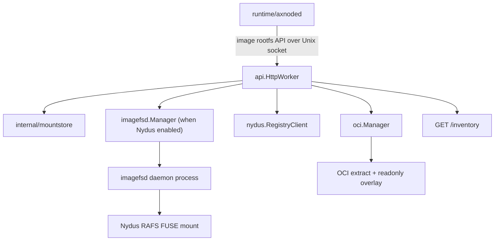
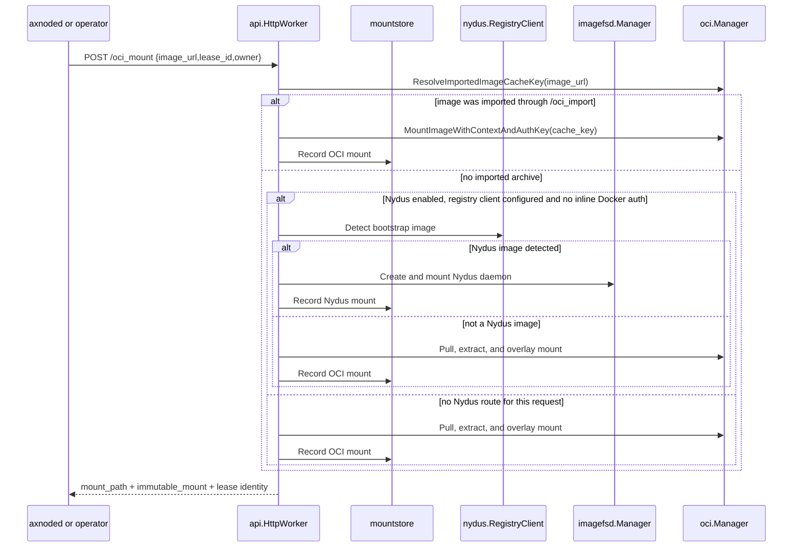

# Imagemgr Architecture

`imagemgr` is the node-local image orchestration daemon used by `axnoded`. It owns API-level mount routing and process orchestration, while image bytes, filesystem reads and OCI extraction stay in their owning packages.

Use this document when changing mount routing, daemon lifecycle, inventory, or the `axnoded` to `imagemgr` integration.

## Implementation Map

## Mount Families

| Entry point         | Primary owner                                  | Result                                                                                    |
| ------------------- | ---------------------------------------------- | ----------------------------------------------------------------------------------------- |
| `POST /nydus_mount` | `api` + `nydus` + `imagefsd`                   | Registry bootstrap mounted as a Nydus RAFS rootfs                                         |
| `POST /oci_mount`   | `api` + `oci`, optionally `nydus` + `imagefsd` | Imported or pulled OCI image exposed as a readonly overlay, unless Nydus routing succeeds |
| `POST /oci_import`  | `api` + `oci`                                  | Local Docker archive imported into the node-local OCI cache                               |

`api.HttpWorker` is the routing point. Keep request validation, lease/resource writes, daemon ID generation, and route selection there instead of moving mount policy into `axnoded` or lower-level packages.

## OCI Mount Routing

Important routing rules:

- Imported images skip Nydus detection and use the local OCI cache.
- OCI-only mode (`-enable_nydus=false`) skips suffix probes and Nydus routing. The OCI owner rejects Nydus formats after fetching the actual image and before publishing imported content, including requests with inline authentication. A detection failure is not permission to extract Nydus bootstrap data as an OCI rootfs.
- Request-scoped Docker config JSON applies only to the OCI pull path.
- If an image is detected as Nydus but the Nydus mount fails, the API returns that error instead of silently falling back to OCI.
- `POST /oci_umount` releases one durable lease. The final lease routes resource cleanup through `oci.Manager` or `imagefsd.Manager`; failed cleanup remains durable for reconciliation.

## Persistence And Ownership

OCI-only startup inspects persisted mount authority and daemon metadata before constructing backend managers. It rejects Nydus resources, retained daemon metadata and unrecognized or corrupt authority without starting recovery or cleanup. It does not migrate or discard these records. The enabled mode remains responsible for releasing its Nydus resources before an operator switches modes. Ordinary OCI resources and pending releases continue through the existing recovery path.

`internal/mountstore` is the sole authority for client-visible resource identity, ownership, and leases. Its `resource_leases.db` decides whether a resource may be retained or unmounted. OCI and Nydus implementations cannot create ownership by discovering backend state.

The OCI `metadata.db` contains only backend recovery state: extracted layer and chain refcounts, imported content, in-flight mount intent, and the `oci_mount_state` projection needed to reconstruct or remove an overlay mount. This state is not a second resource lifecycle. On restart, imagemgr reconciles backend state under the resource/lease authority; an OCI projection without an authoritative resource lease is cleanup work, not a live client resource.

### Guest Metadata And Cache Format

OCI extraction restores explicit root directory ownership, permission bits and timestamps independently of the service umask. A layer without a root header uses root:root `0755` as its standalone default; within an image chain it inherits the preceding chain's effective root metadata. A later explicit root header overrides that metadata. Implicit parent directories use `0755` until an explicit directory entry supplies their metadata. Clone roots preserve these attributes without changing source layers, and inherited root stat metadata never copies a preceding layer's overlay whiteout xattrs.

The OCI metadata database records one extraction format for its complete layer, chain, import and mount-recovery cache. A new or completely empty cache can initialize that format. Unknown or malformed formats, unversioned nonempty records, and unversioned filesystem content are rejected before mount recovery or reuse. Startup never stamps existing content as compatible, changes its permissions recursively or removes it. Normal reuse and restart retain same-format metadata. If a complete extracted directory exists but its layer record was not committed, recovery reopens the source layer stream to recover its root-header fact; source failure remains visible rather than guessing from the directory's current mode.

An incompatible cache requires explicit offline operator resolution, not a routine restart/reset procedure. Keep the matching runtime available to release its owned resources and leases, verify that no workload or mount still owns the cache, and preserve `<imagemgr-root>/oci` together with the authoritative `<imagemgr-root>/resource_leases.db` before replacing any cache state. A fresh dedicated installation uses an empty image cache. This is not an in-place upgrade or migration contract and must not discard PostgreSQL state, node identity, Workspace bytes or unrelated data.

OCI and Nydus resources share the mountstore lease contract. Their resource implementations remain owned by `oci` and `imagefsd`. Each owner returns one bounded flat immutable-mount descriptor; axnoded projection consumes that descriptor and must not reverse-engineer these implementations. Source health and identity stay with imagemgr lease reconciliation, while projection owns only its host OverlayFS and writable artifacts. Callers recover ownership by submitting their complete desired lease set to `POST /reconcile_mount_leases`; reconciliation is scoped to that owner.

Background release scans provide candidates, not release authority. Under the mount lock, the worker reloads the lease and checks that it is still releasing before cleanup. A retained or reacquired lease invalidates an older scan. A releasing lease sharing a resource with another consumer is removed without unmounting that consumer's resource.

OCI manager shutdown stops its workers and closes metadata; it does not unmount resources or decrement their layer/chain references. Process lifecycle is not release authority. The next process recovers projections against actual kernel mounts, while final-lease release remains the normal cleanup path. A host reboot can lose mounts and processes and is not equivalent to restarting the daemon in the same mount namespace.

## Inventory And Cleanup

`GET /inventory` is the read-only node image summary. It combines:

- explicit `imagefsd_enabled` process configuration
- authoritative resources and leases from `internal/mountstore`
- imported and mounted OCI state from `oci.Manager`
- live daemon state from `imagefsd.Manager`
- retained ChunkDB and locality summaries from `imagefsd`

When Nydus is disabled, inventory reports OCI state without executing imagefsd or probing its ChunkDB. Axnoded maps `imagefsd_enabled=false` to a disabled component while retaining imagemgr readiness and OCI locality. An absent field from an older imagemgr preserves the existing consumer behavior. Nydus mount/unmount and daemon cleanup reject requests explicitly; an absent manager is never evidence that a Nydus resource was successfully released.

`POST /cleanup_daemon` removes a specific `imagefsd` daemon by daemon ID. Prefer normal unmount endpoints for mounted rootfs cleanup because they also release the owning mount records and route through the correct package owner.

## Change Routing

- API request or response changes: update `api/types.go`, tests, and `README.md` examples together.
- `imagefsd` daemon invocation changes: update this document, `runtime/imagefsd/docs/architecture.md`, and launch validation.
- Socket, `.dev/`, or rootfs routing changes: update `.x/runtime-stack.md` and the affected subsystem docs together.
